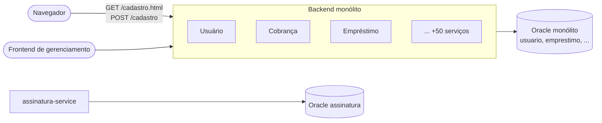
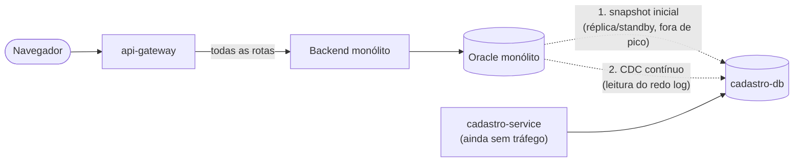
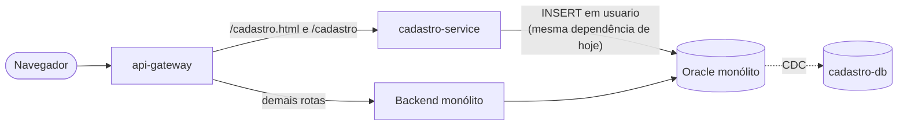
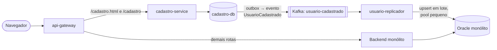
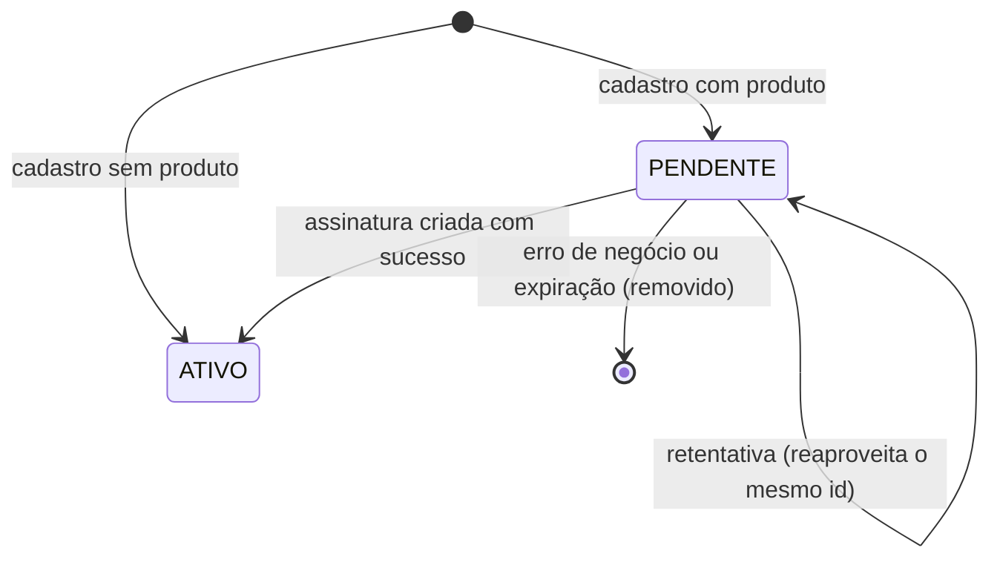
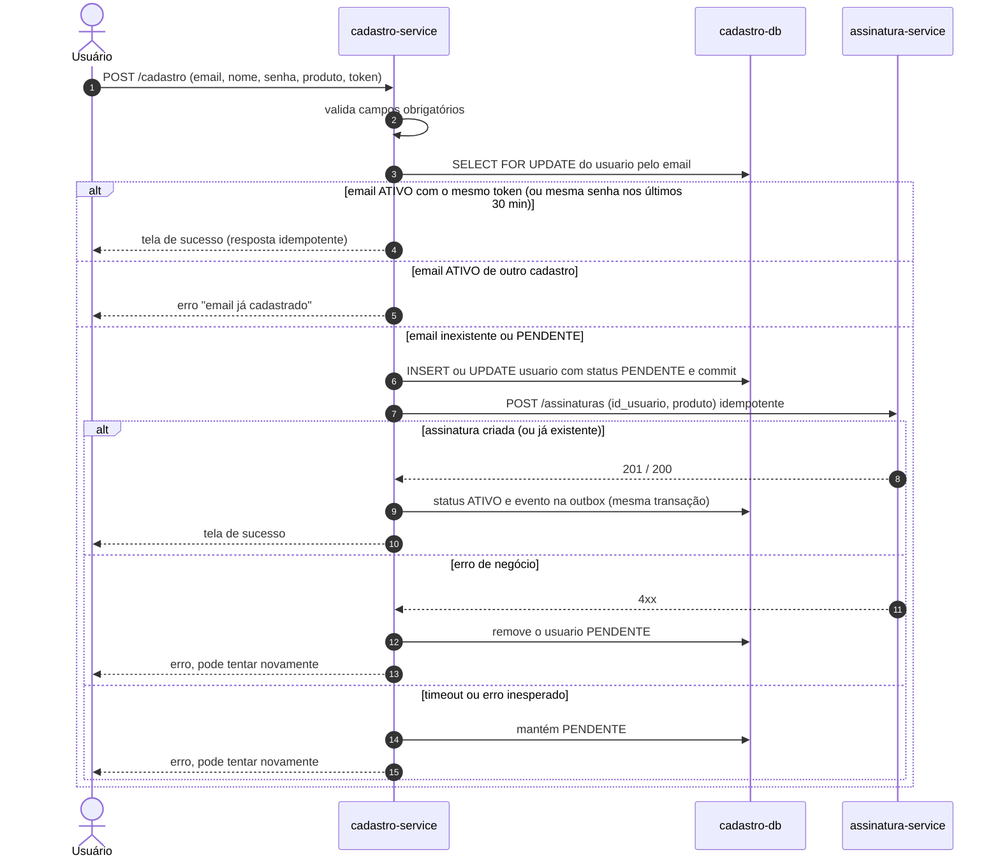
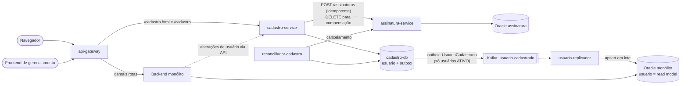

# Trabalho Final – Remoção do Cadastro de Usuários do Monólito

## 1. Objetivo

Remover a dependência síncrona que o cadastro de usuários tem com o monólito, tanto da aplicação quanto do banco Oracle, e incluir a opção de cadastrar o usuário já com uma assinatura. Quando houver produto selecionado, usuário e assinatura precisam ser criados juntos. Em caso de qualquer falha, o usuário deve poder tentar de novo como se nada tivesse sido realizado e nunca receber "email já cadastrado" por causa de uma tentativa anterior que falhou.

O plano é incremental. Cada fase entrega valor sozinha, pode ser revertida e não gera indisponibilidade nem mudança de usabilidade.

---

## 2. Sistemas criados

| Sistema | Responsabilidade |
|---|---|
| **api-gateway** | Proxy na frente do monólito. Decide, por configuração, se as rotas de cadastro vão para o monólito ou para o serviço novo. |
| **cadastro-service** | Novo microsserviço, dono do domínio "usuário". Serve a tela `cadastro.html` (server side, sem JavaScript, mesma usabilidade de hoje), recebe o `POST /cadastro` e orquestra o cadastro com assinatura. |
| **cadastro-db** | Banco próprio do cadastro. É a fonte da verdade de usuários e da unicidade do email (`email UNIQUE`). |
| **Kafka – tópico `usuario-cadastrado`** | Transporta o evento de usuário cadastrado, publicado via *transactional outbox* do cadastro-db. |
| **usuario-replicador** | Worker pequeno, fora do processo do monólito. Consome os eventos e faz *upsert* na tabela `usuario` do Oracle do monólito. |
| **reconciliador-cadastro** | Job do cadastro-service que limpa cadastros com assinatura que ficaram pendentes e foram abandonados. |

Esquema da tabela no **cadastro-db**:

```
usuario
  id_usuario          number   (pk, mesmo id do monólito)
  nome                varchar
  email               varchar  (unique)
  senha_hash          varchar
  status              varchar  (PENDENTE | ATIVO)
  produto_pretendido  varchar  (nullable)
  token_cadastro      varchar  (token do formulário, para idempotência)
  criado_em / ativado_em / atualizado_em

outbox
  id, tipo_evento, payload, criado_em, publicado_em
```

---

## 3. Estado atual



Problemas: o cadastro divide threads, memória, CPU e pool de conexões com mais de 50 serviços e cai junto com o monólito ou com o banco dele.

---

## 4. Fase 0 – Gateway na frente do monólito

Colocamos o **api-gateway** na frente do monólito. Inicialmente ele roteia 100% das requisições para o monólito, então nada muda para o usuário. Com isso, mudar o destino das rotas de cadastro passa a ser só configuração, o que viabiliza as próximas fases e um rollback imediato.

---

## 5. Fase 1 – Banco novo e migração dos dados



1. **Snapshot:** a tabela `usuario` é copiada para o cadastro-db a partir de uma réplica/standby do Oracle. Se não houver réplica, a cópia é feita em lotes pequenos fora do horário de pico, para não consumir recursos do monólito (ponto 5).
2. **CDC:** um CDC (Debezium/LogMiner ou GoldenGate) lê o redo log do Oracle e mantém o cadastro-db sincronizado. Ele não faz consultas na tabela, então o impacto no banco é mínimo.
3. **Reconciliação:** comparamos contagem e checksum por faixa de `id_usuario` até as duas bases ficarem idênticas.
4. **IDs preservados:** o `id_usuario` é migrado com o mesmo valor. Isso é essencial porque várias tabelas do monólito têm FK para ele (ponto 3).

Usuários migrados entram com `status = ATIVO`.

---

## 6. Fase 2 – Virada sem indisponibilidade

A virada é feita em duas etapas, para não existir nenhuma janela em que o cadastro fique fora do ar.

### 6.1 Etapa A – cadastro-service em modo proxy



O gateway passa a mandar as rotas de cadastro para o cadastro-service. Ele serve a mesma tela e grava direto na tabela `usuario` do Oracle do monólito, usando a mesma sequence e a mesma unique de email de hoje. A dependência do banco é a mesma que já existe, mas a **aplicação monólito já deixa de ser usada pelo cadastro**, o que alivia seus recursos. O CDC continua alimentando o cadastro-db.

Se algo der errado, o gateway volta a rota para o monólito.

### 6.2 Etapa B – inversão da escrita



A inversão é uma flag interna do cadastro-service:

1. Ao ligar a flag, o serviço segura as novas requisições de cadastro por alguns milissegundos, até confirmar que o último `id_usuario` que ele inseriu no Oracle já chegou ao cadastro-db via CDC (lag zero). As requisições não recebem erro, só um pouco mais de latência.
2. A sequence do cadastro-db é posicionada em `MAX(id_usuario) + margem de segurança`.
3. O CDC Oracle → cadastro-db é desligado.
4. A partir daí, o cadastro grava apenas no cadastro-db. Na **mesma transação** grava o evento na tabela `outbox`, que é publicada no Kafka.
5. O **usuario-replicador** consome o evento e faz *upsert* (com o `id_usuario` explícito) na tabela `usuario` do Oracle do monólito.

Não existe risco de email duplicado durante a virada, porque desde a etapa A todos os cadastros já passam pelo cadastro-service. O monólito não recebe mais nenhum.

**Rollback:** desligar a flag. Como o replicador manteve a tabela do monólito atualizada, o serviço volta a gravar no Oracle sem perda de dados.

**Ao final da Fase 2, o cadastro não depende de forma síncrona nem da aplicação nem do banco do monólito.** Se o Oracle do monólito cair, os cadastros continuam funcionando, os eventos ficam acumulados no Kafka e o replicador alcança o atraso quando o banco voltar.

---

## 7. Como ficam os pontos de atenção 3, 4 e 5

**FKs para `usuario` (ponto 3):** a tabela `usuario` continua existindo no Oracle do monólito como uma cópia de leitura (*read model*), com os mesmos IDs. Todas as FKs continuam válidas, sem nenhuma alteração.

**Joins nas telas do monólito (ponto 4):** as queries, como a listagem de empréstimos com `inner join usuario`, continuam iguais e com a mesma performance. Nenhuma tela do monólito passa a chamar um serviço remoto.

**Recursos escassos do monólito (ponto 5):**

- O cadastro sai do processo do monólito, o que libera threads, memória e conexões.
- A replicação é feita por um worker **fora** do monólito, com pool pequeno, escrita em lote e limite de taxa.
- A migração usa réplica/standby e CDC por redo log, sem consultas pesadas no banco principal.

**Consistência eventual:** existe uma janela de segundos entre o cadastro e a chegada do usuário no Oracle do monólito. Mitigação: as funcionalidades do monólito que recebem um `id_usuario` ainda inexistente fazem retentativa curta, e o lag do replicador é monitorado com alerta e fila de erros (DLQ).

**Outras escritas em `usuario`:** se o monólito altera dados do usuário, como nome e email, essas operações passam a chamar a API do cadastro-service. A mudança chega de volta ao monólito pelo mesmo evento. A alteração de email, em especial, precisa passar pelo cadastro-service, porque a unicidade agora é garantida no cadastro-db.

---

## 8. Fase 3 – Cadastro com assinatura

### 8.1 Ideia central

O cadastro-service orquestra uma **saga síncrona** (a confirmação acontece na hora, como exigido no ponto 7). O usuário é criado em dois estados:

- **PENDENTE:** o email está reservado, mas o usuário ainda **não existe** para o resto da empresa. Ele não é replicado ao monólito e não pode logar.
- **ATIVO:** cadastro e assinatura concluídos. Só nesse momento o evento `UsuarioCadastrado` é publicado.

Um cadastro sem produto vai direto para `ATIVO`, como na Fase 2.



### 8.2 Mudanças técnicas no assinatura-service

São mudanças de backend, sem impacto em usabilidade. O contrato `POST /assinaturas {id_usuario, produto}` continua igual para quem já o usa.

1. **POST idempotente:** uma constraint unique em `(id_usuario, produto)`. Se a assinatura já existe, o serviço devolve a existente em vez de criar outra ou dar erro. É isso que permite repetir a chamada depois de um timeout sem criar assinatura duplicada.
2. **Cancelamento idempotente:** `DELETE /assinaturas?id_usuario=X&produto=Y`, que responde sucesso mesmo se a assinatura não existir. É usado para compensação.

### 8.3 Token de idempotência no formulário

Ao renderizar `cadastro.html`, o cadastro-service inclui um campo `hidden` com um UUID (`token_cadastro`). Ele é invisível ao usuário e funciona sem JavaScript. Quando o usuário reenvia o mesmo formulário (botão voltar ou atualizar), o token vem igual.

### 8.4 Fluxo do `POST /cadastro` com produto



Detalhes importantes:

- O `SELECT ... FOR UPDATE` e a unique de email no cadastro-db impedem que dois envios simultâneos criem dois usuários.
- O registro `PENDENTE` é commitado **antes** da chamada à assinatura, para não segurar o lock do banco durante uma chamada remota.
- A passagem para `ATIVO` é feita com `UPDATE ... WHERE status = 'PENDENTE'`. O evento na outbox só é gravado se a linha realmente mudou, então dois envios concorrentes do mesmo formulário não geram evento duplicado.
- Um registro `PENDENTE` não é um usuário cadastrado. Por isso, uma nova tentativa com o mesmo email assume o pendente, atualizando nome e senha, e continua com o mesmo `id_usuario`.

### 8.5 Reconciliador de pendentes abandonados

Se o usuário recebe erro e desiste, o pendente não pode ficar para sempre, nem a assinatura que talvez tenha sido criada. A cada poucos minutos, o **reconciliador-cadastro**:

1. Busca usuários `PENDENTE` criados há mais de 30 minutos, travando cada linha (`FOR UPDATE SKIP LOCKED`).
2. Chama o cancelamento idempotente da assinatura (`DELETE /assinaturas?id_usuario&produto`).
3. Remove o usuário pendente, liberando o email.

Se o cancelamento falhar, o pendente é mantido e o job tenta de novo na próxima execução. Se o usuário retentar enquanto o job processa aquela linha, ele espera o lock e depois encontra o email livre, iniciando um cadastro novo.

### 8.6 Cenários de erro (ponto 6)

| Cenário | O que acontece | Retentativa com o mesmo email |
|---|---|---|
| Erro de negócio na assinatura | Pendente removido, erro na tela | Email livre, cadastro novo |
| Timeout ou erro inesperado na assinatura | Pendente mantido, erro na tela | Reaproveita o `id_usuario`. O POST idempotente cria a assinatura ou devolve a já criada |
| assinatura-service fora do ar | Mesmo tratamento do timeout | Igual ao anterior |
| Timeout na criação do usuário | O usuário vê erro. O pendente pode ou não ter sido gravado | Se foi gravado, encontra o `PENDENTE` e retoma. Se não, cadastro novo |
| Tudo deu certo, mas a resposta se perdeu | Usuário `ATIVO` | Mesmo token, ou mesma senha em até 30 min: tela de sucesso, sem erro |
| Usuário desistiu após o erro | Reconciliador cancela a assinatura e remove o pendente após 30 min | Cadastro novo normalmente |
| cadastro-db indisponível | Nada é criado, erro na tela | Fluxo normal |

Em todos os casos de falha, para o usuário **nada foi realizado**. O monólito também não vê nada, porque só usuários `ATIVO` são replicados.

### 8.7 Arquitetura final



---

## 9. Premissas

- A única criação de usuários no monólito é o fluxo de cadastro. Outras alterações de dados do usuário passam a chamar a API do cadastro-service.
- Se o login continuar no monólito, o `senha_hash` vai no evento replicado, num tópico de acesso restrito.
- A infraestrutura de microsserviços, incluindo broker de mensagens e banco para serviços novos, já existe, como diz o enunciado.
- O assinatura-service pode receber as mudanças técnicas da seção 8.2, já que elas não alteram usabilidade nem o contrato atual.

---

## 10. Entregas incrementais (ponto 8)

| Fase | Entrega | Dependência síncrona do monólito no cadastro |
|---|---|---|
| 0 | api-gateway na frente do monólito | Aplicação e banco (sem mudança) |
| 1 | cadastro-db criado e sincronizado via snapshot + CDC | Aplicação e banco (sem mudança) |
| 2A | cadastro-service no ar, gravando no Oracle do monólito | Só o banco |
| 2B | Inversão da escrita + replicação para o monólito | **Nenhuma** |
| 3 | Cadastro com assinatura (saga idempotente + reconciliador) | **Nenhuma** |

Cada fase cabe em poucas sprints e pode ser revertida por configuração. O objetivo principal, que o cadastro não fique indisponível por causa do monólito, já é atingido ao final da Fase 2. O plano é de meses, não de anos.
